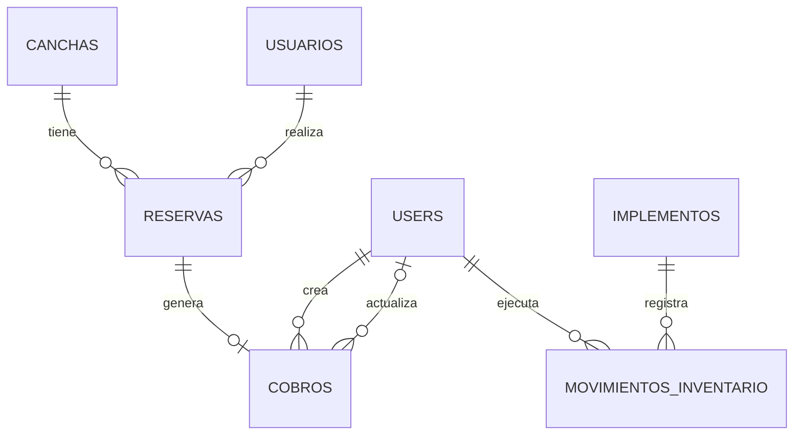

# Especificación funcional y técnica: Cobros e Implementos

**Estado:** Módulos implementados en código; las migraciones aditivas están creadas y no se han ejecutado. Las decisiones listadas como pendientes requieren confirmación antes de cerrar los contratos.

## 1. Introducción y objetivo

Definir los contratos funcionales y técnicos propuestos para Cobros, Implementos y el ajuste de inventario, manteniendo la autenticación JWT propia, los permisos existentes y la protección SOAP. Las reglas de este documento son decisiones de diseño del equipo; no se presentan como requisitos expresos de la profesora.

## 2. Alcance

Operaciones: generar, consultar y actualizar cobros; listar y registrar implementos; y ajustar existencias. No incluye pagos parciales, devoluciones, tarifas de canchas ni operaciones SOAP nuevas.

## 3. Estado actual

La API REST existente tiene login y rutas protegidas por `jwt.auth` para registro, validación SOAP, perfil y logout. Canchas y reservas cuentan con modelos, servicios y repositorios. Se añadieron migraciones y endpoints para cobros e implementos; las migraciones aún no se han ejecutado. `reservas` referencia `canchas` y `usuarios`; `users` contiene las cuentas autenticadas y roles, y es distinta de `usuarios`. Las canchas no tienen tarifa.

`SoapConnectionService` llama internamente a `consultarReservas` mediante `UsernameTokenSoapClient`; la autorización SOAP carga el usuario real por `sub`, acepta JWT normal de administrador/recepcionista, y para cajero exige capability de 30 segundos, alcance y audiencia exclusivos y consumo único. La emisión está limitada a la ruta llamada `api.cobros.consultar`.

## 4. Roles y matriz de permisos

Todas las rutas salvo login requieren JWT. El 401 y el 403 conservan el formato actual; el cuerpo 403 es `{"error":"Permisos insuficientes para ejecutar este método"}`.

| Operación | Administrador | Recepcionista | Cajero | Encargado inventario | Middleware existente |
|---|---:|---:|---:|---:|---|
| generarCobro | Sí | Sí | No | No | `can.manage.billing` |
| consultarCobro | Sí | Sí | Sí | No | `can.consult.billing` (OR) |
| marcar pagado | Sí | No | Sí | No | `can.update.payment.status` más regla de servicio |
| anular cobro | Sí | No | No | No | Regla de servicio además del middleware general |
| listarImplementos | Sí | Sí | No | Sí | `can.list.equipment` (OR) |
| registrarImplemento | Sí | No | No | Sí | `can.manage.equipment` |
| ajustarStock | Sí | No | No | Sí | `can.manage.equipment` |

`ajustarStock` amplía el alcance inicial acordado por el equipo. El middleware `can.manage.equipment` ya representa administrador o encargado de inventario, por lo que es coherente reutilizarlo; no se solicita modificarlo.

## 5. Especificación funcional de Cobros

Decisiones acordadas: máximo un cobro por reserva; sin pagos parciales ni devoluciones; importe ingresado al generar, COP, estrictamente mayor que cero; estado inicial `pendiente`; estados `pendiente`, `pagado`, `anulado`; transiciones normales `pendiente → pagado` y `pendiente → anulado`; estados finales inmutables por el flujo normal. Métodos: `efectivo`, `transferencia`, `tarjeta`, capturados al marcar pagado. Fecha de pago del servidor. Auditoría con usuario creador y último actualizador. El cliente no puede controlar IDs de auditoría ni campos internos. Solo administrador puede anular; el servicio debe verificarlo además del middleware.

La entrada REST valida el máximo representable por `DECIMAL(12,2)` (`9999999999.99`); es un límite técnico de almacenamiento, no un tope comercial acordado. La generación asigna `fecha_generacion` con la hora del servidor y deja `updated_by_user_id` nulo hasta la primera actualización; confirmar este comportamiento y la relación de `fecha_generacion` con `created_at` sigue pendiente.

| Campo de `cobros` | Tipo propuesto | Uso |
|---|---|---|
| `id` | BIGINT UNSIGNED PK | Identificador |
| `reserva_id` | INT (signed) UNIQUE FK | Reserva asociada; coincide con `reservas.id` del esquema SQL revisado (`INT` firmado) |
| `monto` | DECIMAL(12,2) | Importe positivo |
| `moneda` | CHAR(3) | Siempre COP en esta versión |
| `estado` | VARCHAR(20) | Estado acordado |
| `metodo_pago` | VARCHAR(30), nullable | Se completa al pagar |
| `referencia_transaccion` | VARCHAR(100), nullable | Referencia, reglas pendientes |
| `fecha_generacion` | DATETIME | Fecha asignada por servidor |
| `fecha_pago` | DATETIME nullable | Fecha asignada por servidor al pagar |
| `created_by_user_id` | BIGINT UNSIGNED FK users | Creador autenticado |
| `updated_by_user_id` | BIGINT UNSIGNED nullable FK users | Último actualizador |
| timestamps | timestamps Laravel | Creación y actualización |

## 6. Especificación funcional de Implementos

Código obligatorio y único; nombre y categoría obligatorios; descripción y ubicación opcionales; cantidad entera no negativa; estado inicial `activo`, valores `activo`, `mantenimiento`, `retirado`. Estado y cantidad son independientes: activo con cantidad cero sigue activo, pero no disponible para uso. Repetir código no crea ni incrementa stock.

| Campo de `implementos` | Tipo propuesto | Uso |
|---|---|---|
| `id` | BIGINT UNSIGNED PK | Identificador |
| `codigo` | VARCHAR(40) UNIQUE | Identificador funcional |
| `nombre` | VARCHAR(100) | Obligatorio |
| `categoria` | VARCHAR(60) | Obligatoria |
| `descripcion` | TEXT nullable | Opcional |
| `cantidad_disponible` | INT UNSIGNED | No negativa |
| `estado` | VARCHAR(20) | Valores acordados |
| `ubicacion` | VARCHAR(100) nullable | Opcional |
| timestamps | timestamps Laravel | Auditoría temporal |

## 7. Ajustes y movimientos de inventario

`ajustarStock` registra entrada o salida de cantidad estrictamente positiva, motivo obligatorio, usuario y fecha. Entrada suma; salida resta y se rechaza si supera existencias. La actualización del implemento y la inserción del movimiento se ejecutan en una transacción; el servicio bloquea la fila con `lockForUpdate()` durante la operación. El comportamiento actual no restringe ajustes por estado (`activo`, `mantenimiento` o `retirado`); confirmar si debe haber restricciones por estado sigue pendiente. La API no ofrece edición ni eliminación de movimientos; su política formal de inmutabilidad sigue pendiente.

| Campo de `movimientos_inventario` | Tipo propuesto | Uso |
|---|---|---|
| `id` | BIGINT UNSIGNED PK | Identificador |
| `implemento_id` | BIGINT UNSIGNED FK implementos | Implemento afectado |
| `user_id` | BIGINT UNSIGNED FK users | Usuario autenticado responsable |
| `tipo_movimiento` | VARCHAR(10) | `entrada` o `salida` |
| `cantidad` | INT UNSIGNED | Positiva |
| `cantidad_anterior` | INT UNSIGNED | Existencia antes |
| `cantidad_posterior` | INT UNSIGNED | Existencia después |
| `motivo` | VARCHAR(500) | Obligatorio |
| timestamps | timestamps Laravel | Fecha/hora del movimiento |

## 8. Operaciones REST

| Método y ruta | Nombre | Permiso |
|---|---|---|
| POST `/api/cobros` | `api.cobros.generar` | `jwt.auth`, `can.manage.billing` |
| GET `/api/cobros/{cobro}` | `api.cobros.consultar` | `jwt.auth`, `can.consult.billing` |
| PATCH `/api/cobros/{cobro}/estado` | `api.cobros.actualizarEstado` | `jwt.auth`, `can.update.payment.status` y regla de servicio para anulación |
| GET `/api/implementos` | `api.implementos.listar` | `jwt.auth`, `can.list.equipment` |
| POST `/api/implementos` | `api.implementos.registrar` | `jwt.auth`, `can.manage.equipment` |
| POST `/api/implementos/{implemento}/ajustar-stock` | `api.implementos.ajustarStock` | `jwt.auth`, `can.manage.equipment` |

El nombre `api.cobros.consultar` debe conservarse literalmente para la autorización de emisión temporal SOAP.

## 9. Integración SOAP y WS-Security

Administrador y recepcionista consultan con su JWT normal y continúan presentando WS-Security UsernameToken. Su JWT normal puede enviarse como argumento `token` de `consultarReservas()`. El cajero accede con su JWT normal a la ruta REST autenticada y autorizada; solo en esa ruta el servidor puede emitir internamente una credencial temporal para `consultarReservas()`.

La credencial temporal es un JWT HS256 separado del JWT de sesión, con `sub` igual al ID del usuario cajero, `token_use=soap_capability`, `scope=soap:consultarReservas`, `aud=urn:ReservasCanchas#consultarReservas`, `jti` UUID y expiración a los 30 segundos. La emisión requiere que la ruta autenticada tenga exactamente el nombre `api.cobros.consultar`, que `jwt.auth` haya resuelto el usuario y verificado sus claims, que el usuario actual siga teniendo rol `cajero` y que la solicitud presente el JWT normal autenticado. La credencial va en el argumento existente `token` de `consultarReservas()`; el cliente SOAP sigue enviando UsernameToken WS-Security. No se devuelve al cliente REST ni se registra.

SOAP carga el usuario actual desde `users` y comprueba su rol. El JWT normal de cajero no autoriza `consultarReservas()` y el encargado de inventario queda denegado. Los JWT que contengan marcadores de credencial temporal se rechazan en `jwt.auth` REST y en las operaciones SOAP existentes distintas de `consultarReservas()`.

La credencial se consume una sola vez antes de leer las reservas, mediante `Cache::add()` con una clave derivada del `jti` y TTL igual al tiempo restante hasta `exp`. Si la clave ya existe o el JWT expiró, se rechaza la llamada; no se debe reemplazar por una secuencia separada `has()` y `put()`. Con el cache local `file`, todos los procesos SOAP deben compartir `storage/framework/cache/data` en el mismo sistema de archivos para mantener la atomicidad; instancias con discos locales separados requieren un almacén compartido con inserción atómica, como Redis.

En `consultarCobro`, una respuesta SOAP exitosa se filtra por el ID de reserva del cobro. Si SOAP falla, devuelve una respuesta no exitosa o no incluye esa reserva, REST responde con error controlado HTTP 502 y no incluye el token temporal. La estructura JSON actual es provisional mientras se confirma el contrato definitivo.

Se conservan endpoint, WSDL, firma, argumentos y WS-Security SOAP actuales. La respuesta SOAP se filtra en Laravel por el `reserva_id` vinculado al cobro; esta consulta no devuelve la lista completa de reservas.

## 10. Modelo de datos y relaciones

- `canchas 1—N reservas`; `usuarios 1—N reservas` (existentes).
- `reservas 1—0..1 cobros` por `cobros.reserva_id UNIQUE`.
- `users 1—N cobros` como creador; cada cobro puede tener cero o un usuario actualizador (`updated_by_user_id` nullable).
- `implementos 1—N movimientos_inventario`; `users 1—N movimientos_inventario`.
- `users` y `usuarios` permanecen separados.



## 11. Modelos, controladores, servicios y repositorios

Implementado: `Cobro` pertenece a `Reserva` y a `User` en los campos de auditoría; `Reserva` tiene relación uno a uno con `Cobro`. `Implemento` tiene muchos `MovimientoInventario`; este pertenece a `Implemento` y `User`. Controladores HTTP delegan a `CobroService`, `ImplementoService` e `InventarioService`; repositorios encapsulan consultas y persistencia. Los servicios aplican transiciones, autorización de anulación, transacciones y bloqueo de filas.

## 12. Datos JSON ilustrativos

Los contratos JSON definitivos quedan pendientes de confirmación. Los códigos de éxito y algunas respuestas de conflicto documentadas en la sección 14 describen el comportamiento actual provisional y también requieren confirmación.

```json
POST /api/cobros
{"reserva_id":123,"monto":"45000.00"}
```

```json
PATCH /api/cobros/{id}/estado
{"estado":"pagado","metodo_pago":"transferencia","referencia_transaccion":"<opcional>"}
```

```json
POST /api/implementos
{"codigo":"BAL-01","nombre":"Balón","categoria":"balon","cantidad_disponible":4,"estado":"activo"}
```

```json
POST /api/implementos/{id}/ajustar-stock
{"tipo_movimiento":"salida","cantidad":1,"motivo":"Daño reportado"}
```

Las respuestas deben omitir credenciales, auditoría interna no autorizada y datos de reservas no relacionados.

## 13. Validaciones, seguridad y respuestas

Aplicar validaciones de campos, relaciones existentes, unicidad, transiciones, roles, disponibilidad y concurrencia. Capturar usuario de `$request->user()`, nunca de IDs enviados por cliente. El 401 para JWT ausente/inválido y el 403 exacto para permiso insuficiente siguen el comportamiento actual. La implementación usa actualmente 404 para recurso inexistente, 409 para duplicado o conflicto de negocio, 422 para validación y 502 cuando SOAP no puede aportar la reserva asociada; los códigos de éxito y la asignación final de los demás códigos siguen pendientes de confirmación. Los cuerpos JSON son provisionales. Ninguna respuesta incluye tokens ni secretos.

## 14. Clases y flujo por operación

| Operación | Objetivo y actor | Datos/validación | Clases e interacción con MySQL | Respuesta/errores |
|---|---|---|---|---|
| generarCobro | Crear cobro; admin/recepcionista | reserva existente, monto >0 y capacidad de `DECIMAL(12,2)`; no filtra estado de reserva | Ruta → middlewares → controller → service/repository; inserta cobro y auditoría | Actualmente 201; errores descritos en §13 |
| consultarCobro | Consultar cobro/reserva; admin/recepcionista/cajero | ID; consultar SOAP y filtrar reserva asociada | Service lee cobro; cajero obtiene capability privada; llama SOAP; Laravel filtra | Actualmente 200; 404/502 según §13 |
| actualizarEstadoCobro | Marcar pagado o anular | pagado requiere método; solo pendiente cambia; anular solo admin en servicio | Service bloquea y actualiza cobro, fecha y usuario | Actualmente 200; 403/404/409/422 según caso |
| listarImplementos | Consultar catálogo; admin/recepcionista/encargado | filtros/paginación por definir; orden actual por ID | Repository lee la colección ordenada por ID | Actualmente 200; 401/403 |
| registrarImplemento | Crear ficha; admin/encargado | código único, nombre, categoría, cantidad ≥0, estado válido; no incrementa duplicados | Service/repository inserta; estado activo por defecto | Actualmente 201; 409 para código duplicado |
| ajustarStock | Registrar entrada/salida; admin/encargado | tipo, cantidad >0, motivo; salida no excede stock | Transacción y bloqueo de fila; actualiza cantidad e inserta movimiento con saldos | Actualmente 200; 404/409/422 según caso |

Ejemplo conceptual de consulta de cajero: REST valida JWT y rol → Laravel lee el cobro de MySQL → emite capability privada → cliente SOAP añade UsernameToken y envía token → servicio SOAP valida y consume `jti`, lee reservas → Laravel filtra por la reserva del cobro → REST responde sin el token.

## 15. Pruebas previstas

Probar matriz completa de roles, ausencia/token inválido, usuario sin rol, JSON 403 exacto, y que administrador no quede bloqueado por permisos OR. Cobros: monto/moneda, unicidad por reserva, usuarios de auditoría, transiciones finales, anulación solo admin, método requerido al pagar y respuesta SOAP sin capability. Implementos: código duplicado, cantidad no negativa, estados y permisos. Inventario: entradas/salidas, salida excesiva, motivo, snapshot anterior/posterior y rollback ante fallo. SOAP: flujo admin/recepcionista/cajero, cajero directo denegado, token temporal expirado/reutilizado, WSS inválido, filtro de reserva y regresión de operaciones SOAP existentes. Las pruebas actuales no verifican concurrencia real: SQLite en memoria ignora la semántica de bloqueo que debe comprobarse con MySQL/InnoDB.

## 16. Decisiones acordadas y pendientes

**Acordado por el equipo:** reglas de cobros e implementos descritas; COP; transiciones; roles; auditoría; movimiento de inventario; `ajustarStock` como ampliación; reutilización coherente de `can.manage.equipment`; preservación integral de SOAP.

**Pendiente antes de cerrar los contratos:** estados de reserva elegibles para cobro; contenido exacto de `consultarCobro`; reglas para referencia de transferencia/tarjeta; filtros y paginación; contratos JSON definitivos; confirmación de permitir cantidad cero al registrar (la implementación actual sí la permite por ser no negativa); límites comerciales, precisión y redondeo del monto (el máximo técnico actual deriva de `DECIMAL(12,2)`); inmutabilidad del monto; relación entre `fecha_generacion` y `created_at`, y si `updated_by_user_id` debe iniciar con el creador o `NULL`; comportamiento de ajustes de inventario para implementos en `mantenimiento` o `retirado`; códigos HTTP de éxito y asignación definitiva de errores; inmutabilidad formal de los movimientos; y límites que excedan la capacidad técnica del esquema para código y motivo. La implementación actual permite ajustar inventarios sin restricción por estado y no expone endpoints para editar o borrar movimientos.

## 17. Plan de implementación por etapas

1. Implementación y documentación creadas; revisar cambios locales antes de integrarlos.
2. Confirmar pendientes funcionales y contratos JSON/HTTP.
3. Respaldar la base existente e importar el SQL heredado solo en una base vacía si aún no está instalada.
4. Ejecutar `php artisan migrate` para aplicar exclusivamente las nuevas migraciones aditivas; no usar `migrate:fresh`.
5. Probar la integración SOAP en el entorno con WSDL y credenciales WS-Security configurados.
6. Completar una prueba de concurrencia en MySQL/InnoDB; SQLite en memoria no valida la semántica real de `lockForUpdate()`.
